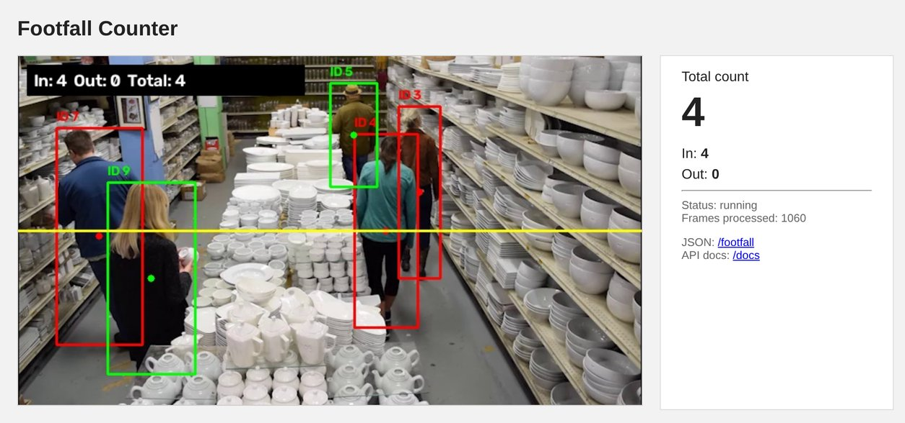
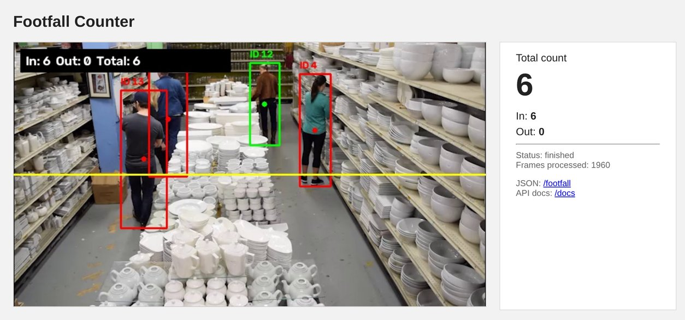
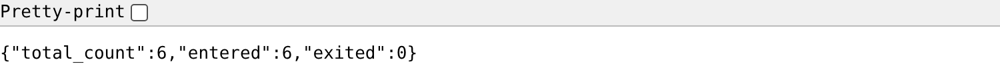
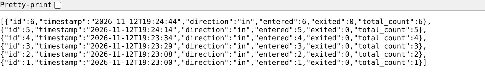

# Footfall Counter API

A small FastAPI service that counts how many people cross a virtual line in a video.
It uses **YOLOv8** (through the `ultralytics` package) to detect and track people and
**OpenCV** to read the video and draw on the frames.

Built for the Junior AI/Backend Engineer technical assignment (Sensoryneurons Edutainment).



---

## How it works

```
video ──> OpenCV ──> YOLOv8 track (person only) ──> LineCounter ──> SQLite
                              │                          │
                       annotated frame                 counts
                              │                          │
                          GET /frame                GET /footfall
```

1. When the server starts, a background thread opens the video with OpenCV.
2. Each frame is passed to `model.track(..., classes=[0], persist=True)`. Class `0` is
   "person" in COCO. Tracking (ByteTrack, the ultralytics default) gives every person an
   ID that stays the same between frames.
3. A horizontal line is drawn across the frame at `LINE_POSITION` (default: middle).
4. For every tracked person I take the centre of the bounding box and compare its `y`
   with the value from the previous frame:
   - was below the line, now above it (walking away from the camera) → **in**
   - was above the line, now on/below it (walking towards the camera) → **out**
5. Each ID is counted only once, so someone standing on the line and moving a little
   does not increase the count again and again.
6. Every crossing is saved to SQLite with a timestamp.
7. FastAPI returns the current counts. The home page shows the latest annotated frame
   and the live count.

Boxes are green before a person is counted and turn red after they cross the line.

## Project structure

```
Footfall-Counter/
├── app/
│   ├── main.py             # FastAPI app and endpoints
│   ├── video_processor.py  # OpenCV + YOLOv8 loop (runs in a background thread)
│   ├── line_counter.py     # line crossing logic (no YOLO, easy to test)
│   ├── database.py         # SQLite helpers
│   ├── config.py           # settings from environment variables
│   └── static/index.html   # simple page: video + live count
├── tests/                  # pytest tests for counting logic and database
├── videos/store-aisle.mp4  # sample video
├── docs/                  # screenshots used in this README
├── Dockerfile
├── requirements.txt
└── README.md
```

## Setup

Needs Python 3.10 or newer.

```bash
git clone https://github.com/Harshithakeshav24/Footfall-Counter.git
cd Footfall-Counter

python3 -m venv .venv
source .venv/bin/activate          # Windows: .venv\Scripts\activate

# optional: CPU-only PyTorch, much smaller download than the default build
pip install torch torchvision --index-url https://download.pytorch.org/whl/cpu

pip install -r requirements.txt
```

The YOLOv8 nano weights (`yolov8n.pt`, ~6 MB) are downloaded automatically the first time.

> **Note for Windows:** on my laptop, Windows Smart App Control blocked one of PyTorch's
> DLLs (`OSError: [WinError 4551] ... torch\lib\shm.dll`), so `from ultralytics import YOLO`
> failed. I did not want to turn off the security setting, so I run the project inside
> **WSL2 (Ubuntu)** instead. Docker also works.
>
> In a fresh Ubuntu (WSL) I first needed:
> `sudo apt install -y python3-venv python3-pip libgl1 libglib2.0-0`

## Run

```bash
uvicorn app.main:app --host 0.0.0.0 --port 8000
```

Then open:

| URL | What it shows |
|-----|---------------|
| http://localhost:8000 | video with boxes, the line and the live counter |
| http://localhost:8000/footfall | current count as JSON |
| http://localhost:8000/docs | Swagger UI for all endpoints |

The video starts processing as soon as the server starts. The count stays available
after the video ends. Stop the server with `Ctrl+C`.

## API

### `GET /footfall`

```json
{"total_count": 6, "entered": 6, "exited": 0}
```

`total_count = entered + exited`

### `GET /footfall/history?limit=2`

Latest crossings saved in SQLite, newest first.

```json
[
  {"id": 6, "timestamp": "2026-11-12T10:21:52", "direction": "in", "entered": 6, "exited": 0, "total_count": 6},
  {"id": 5, "timestamp": "2026-11-12T10:21:19", "direction": "in", "entered": 5, "exited": 0, "total_count": 5}
]
```

### `GET /status`

```json
{"status": "running", "frames_processed": 812, "video_source": "videos/store-aisle.mp4"}
```

Status is one of `not started`, `loading model`, `running`, `finished`, `stopped` or `error: ...`.

### `GET /frame`

Latest processed frame (boxes, IDs, line and counts drawn on it) as a JPEG.
The home page reloads this image to show the video.

## Configuration

All settings are environment variables (see `app/config.py`):

| Variable | Default | Description |
|----------|---------|-------------|
| `VIDEO_SOURCE` | `videos/store-aisle.mp4` | video file, RTSP url, or `0` for webcam |
| `MODEL_PATH` | `yolov8n.pt` | any YOLOv8 model (`yolov8s.pt` is more accurate but slower) |
| `LINE_POSITION` | `0.5` | line height as a fraction of the frame (0 = top, 1 = bottom) |
| `CONFIDENCE` | `0.4` | minimum detection confidence |
| `FRAME_STEP` | `2` | process every Nth frame (the sample video is 60 fps, so 2 = 30 fps) |
| `DB_PATH` | `data/footfall.db` | SQLite file |

Example:

```bash
LINE_POSITION=0.6 FRAME_STEP=1 uvicorn app.main:app --host 0.0.0.0 --port 8000
```

## Docker

```bash
docker build -t footfall-counter .
docker run -p 8000:8000 footfall-counter
```

To keep the SQLite file after the container stops:

```bash
docker run -p 8000:8000 -v "$(pwd)/data:/app/data" footfall-counter
```

Settings can be passed with `-e`, e.g. `-e LINE_POSITION=0.6`.

## Database

Table `footfall_log` (one row per crossing):

| Column | Type |
|--------|------|
| id | INTEGER (primary key) |
| timestamp | TEXT (ISO format) |
| direction | TEXT (`in` / `out`) |
| entered | INTEGER |
| exited | INTEGER |
| total_count | INTEGER |

The easiest way to check it is `GET /footfall/history`. With the sqlite3 CLI:

```bash
sqlite3 data/footfall.db "SELECT * FROM footfall_log ORDER BY id DESC LIMIT 5;"
```

## Tests

```bash
pytest
```

The tests cover the line crossing logic and the database functions. They do not need
the YOLO model, so they run in under a second.

## Results on the sample video

I watched the sample video and counted **6 people** walking up the aisle past the middle
of the frame. Nobody walks down past the line, so `exited` stays 0 for this video.

| Setting | Counted | Comment |
|---------|---------|---------|
| `FRAME_STEP=2`, line at 0.5 (default) | 6 | matches my manual count |
| `FRAME_STEP=1`, line at 0.5 | 7 | one woman was hidden behind another shopper and got a new ID, so she was counted twice |

On a 2-core CPU, `yolov8n` takes about 80 ms per frame, so the 65 second video takes around
3 minutes with `FRAME_STEP=2`.

## Screenshots

While the video is running (green box = not counted yet, red box = already crossed the line):


After the whole video is processed:



`GET /footfall`



`GET /footfall/history` (rows saved in SQLite)



## Limitations

- If the tracker loses a person (for example behind another person) and gives them a
  new ID, they can be counted twice (see the table above).
- A person who goes in and comes back out in the same video is counted only once.
- The centre of the box is used. I also tried the bottom of the box (feet), but in this
  video the feet are often hidden behind the tables, so the centre worked better.
- The in-memory count starts from 0 every time the server restarts. Old crossings stay
  in the database.
- One video source per server.

## Credits

- Sample video: `store-aisle-detection.mp4` from
  [intel-iot-devkit/sample-videos](https://github.com/intel-iot-devkit/sample-videos),
  licensed under CC BY 4.0.
- [Ultralytics YOLOv8](https://docs.ultralytics.com/) for detection and tracking.
